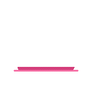
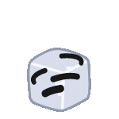
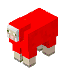

  <h1>Hi there, I'm AstroSoup. Nice to meet you!</h1>
  <h3>
    My name is Semyon Gorin, I'm 20 years old and currently studying at ITMO University.
    Feel free to check out my projects, raise issues and submit PRs if you think something could be better.
  </h3>

  <h2>About me</h2>
  
  <ul>
    <li>
      
      I live in Saint-Petersburg, Russia
    </li>
    <li>
      
      I'm a 3rd year undergraduate student in the "System and Applied Software" program at ITMO University
    </li>
    <li>
      
      I am a winner of many Olympiads from the list of the Russian Council of School Olympiads
    </li>
    <li>
      
      I like to play board games in my free time
    </li>
    <li>
      
      I love building and creating in Minecraft!
    </li>
  </ul>
   

<h2>Tools and programming languages that I use</h2>

<ul>
  <li>
    <b>Programming languages</b>&nbsp;&nbsp;
    
    
    
    
  </li>

  <li>
    <b>Databases</b>&nbsp;&nbsp;
    
    
    
  </li>

  <li>
    <b>Backend</b>&nbsp;&nbsp;
    
    
    
  </li>

  <li>
    <b>Frontend</b>&nbsp;&nbsp;
    
    
    
    
    
  </li>

  <li>
    <b>Build tools</b>&nbsp;&nbsp;
    
    
    
    
  </li>

  <li>
    <b>Version control</b>&nbsp;&nbsp;
    
    
  </li>

  <li>
    <b>AI</b>&nbsp;&nbsp;
    
    
    
  </li>
  
   <li>
    <b>OS</b>&nbsp;&nbsp;
    
    
    
  </li>

  <li>
    <b>Markup</b>&nbsp;&nbsp;
    
    
    
  </li>
 </ul>

<h2>My contacts</h2>

  
  
  
  
   
  

